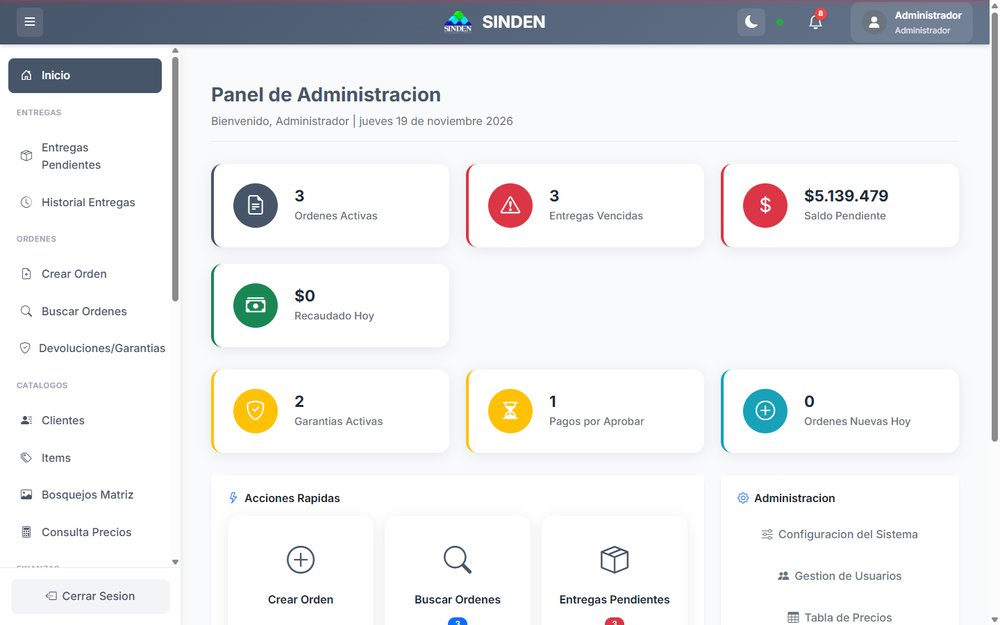
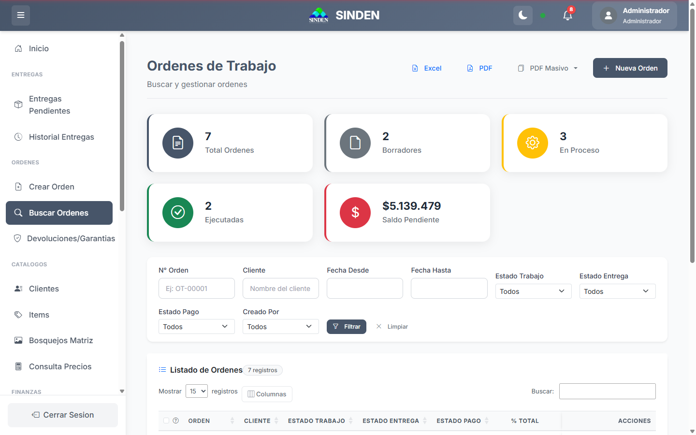
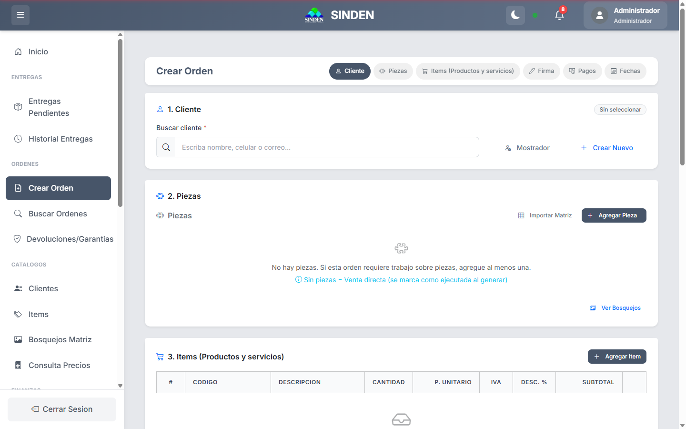
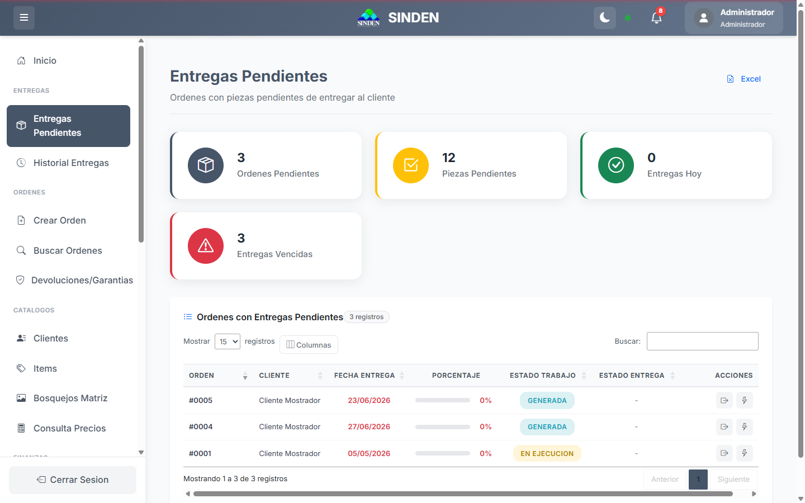
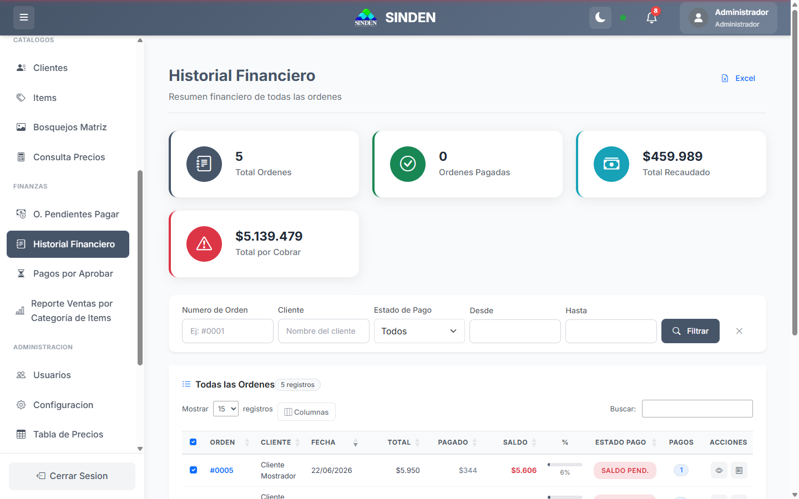
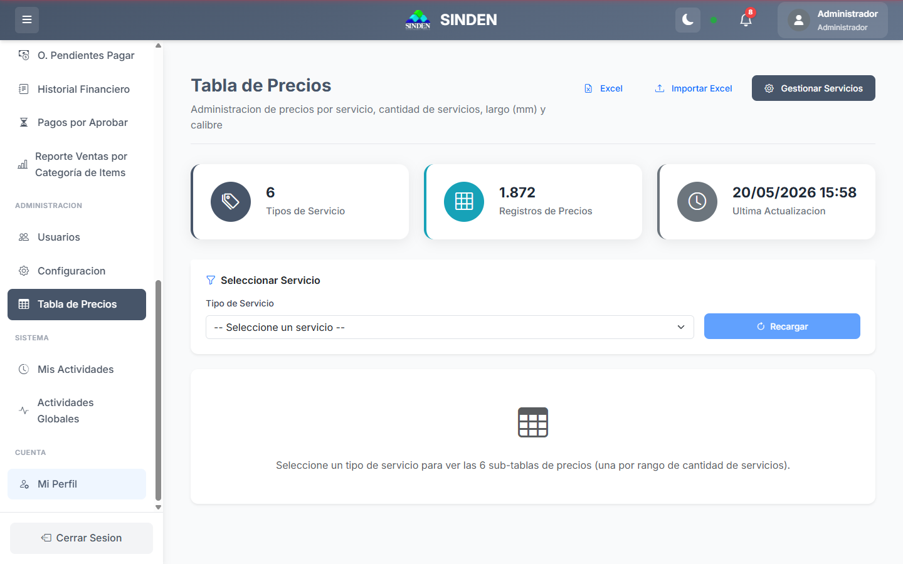

# SINDEN — Órdenes de producción para taller de láminas metálicas

Sistema que controla el proceso completo de un taller de corte y doblez de láminas de metal: recepción de la orden, piezas, bosquejos, producción, pagos y entrega.



## Contexto

En el taller cada pedido tiene muchas piezas con medidas, calibres y dobleces distintos. Las órdenes se tomaban en papel con dibujos a mano y era difícil saber qué estaba listo, qué se debía y qué faltaba entregar.

## Funcionalidades

- **Órdenes de trabajo** por etapas: cliente → piezas → ítems (productos y servicios) → firma → pagos → fechas.
- **Bosquejos:** dibujo a mano alzada en pantalla táctil, plantillas reutilizables y matriz de bosquejos por grupo.
- **Seguimiento de producción** por pieza, con porcentaje de avance, observaciones, fotos y documentos.
- **Entregas parciales y totales**, entregas vencidas e historial.
- **Tabla de precios por servicio** (según calibre, largo en mm y cantidad), importable desde Excel, y consulta rápida de precios.
- **Contabilidad:** pagos pendientes de aprobación, saldos por cobrar, historial financiero y reporte de ventas por categoría.
- **Garantías y devoluciones**, notificaciones y registro de actividades por usuario.
- Roles: administrador, recepción, contabilidad y operario.

## Stack

- **Backend:** PHP 8, Laravel 9, MySQL/MariaDB
- **Autenticación y permisos:** Laravel Breeze + spatie/laravel-permission (roles y permisos)
- **Frontend:** Blade, Livewire, Alpine.js, Tailwind CSS, Bootstrap, DataTables, Canvas API (bosquejos)
- **Documentos:** DomPDF, Laravel Excel, Intervention Image

## Capturas

**Órdenes de trabajo**



**Creación de orden por pasos**



**Entregas pendientes**



**Historial financiero**



**Tabla de precios por servicio**



## Instalación local

Requisitos: PHP 8.0+ (con extensiones `gd`, `zip`, `intl`), Composer, Node 18+ y MySQL/MariaDB.

```bash
git clone <url-del-repositorio>
cd sinden
composer install
npm install && npm run build
cp .env.example .env        # configura la conexión a la base de datos
php artisan key:generate
php artisan migrate --seed
php artisan serve
```

La aplicación queda disponible en `http://localhost:8000`. Los seeders crean los roles y datos iniciales (revisa `database/seeders`).

## Notas

- Proyecto desarrollado para un cliente real y desplegado en producción. Las capturas se tomaron en un entorno local; el historial de este repositorio se depuró para no incluir credenciales ni copias de bases de datos.

## Autor

**Santiago Bellaizán** — Desarrollador Full Stack (Laravel · PHP · MySQL · JavaScript)

- GitHub: [@Santibc](https://github.com/Santibc)
